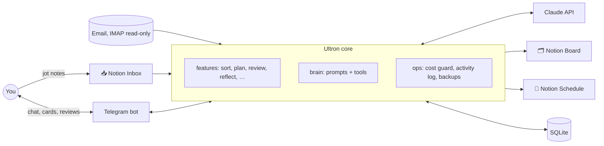

# Ultron

A personal assistant that holds you accountable. It reads your email, sorts the notes you jot in Notion, plans your days around your fixed schedule, talks with you on Telegram, and follows up on what you said you'd do.

Built in Python on the Claude API, Notion and Telegram. Runs on a small VPS in Docker.

## What it does

- **Sorts your notes.** You write anything in a Notion 📥 Inbox page. Every hour Ultron files it onto a 🗂 Board (to-dos, goals, habits, ideas, projects, facts about you), including progress updates on things already there, and keeps your original words.
- **Reads your email, read-only.** Bills, deadlines and replies people are waiting on become to-dos; important mail gets one Telegram ping. Nothing is ever sent, moved or deleted.
- **Plans your days.** At 21:00 it suggests what would move the needle most, asks for your priorities, and drafts timed blocks for the next two days around your fixed schedule. Nothing reaches the 📅 Schedule page until you approve it.
- **Holds you to it.** A morning brief, a midday check-in, an evening review (✅ / ◐ / ❌ per block, what got in the way), call-outs for things that keep slipping, and a Sunday weekly review.
- **Talks with you.** Chat on Telegram to look things up, tick things off or add to-dos. `/reflect` opens a coaching conversation that ends as a short journal entry.
- **Learns how you work, in the open.** Everything it knows about you is on your Board, where you can edit it. Lasting changes (a habit, your focus, your planning settings, its coaching style) are proposed as cards you Apply or Dismiss, never made silently.

## How it's built



- **Front end kept apart from the core.** Features return plain data and send messages through a `Notifier` protocol; only `ultron/bot/` imports Telegram, so another front end (e.g. a phone app) can sit on the same core.
- **Notion is the owner's UI, SQLite the structure behind it.** Three Notion pages, edited by both sides: owner edits on the Board win and are read back before Ultron rewrites a section. SQLite holds estimates, due dates, completion history, sync cursors and links to Board blocks.
- **Your profile, not hard-coded rules.** Coaching style, routines and planning rules are facts on the Board; planning numbers (share of free time to fill, gaps, block limits, wind-down) are per-owner settings. Code checks every drafted plan against them and gives Claude one retry with the reasons.
- **Safety by design.** Email bodies, notes and tool results are wrapped as untrusted data, never instructions. Blocklisted senders are never fetched. The agent has no outbound tools (no sending, browsing or deleting). Only the owner's Telegram ID is answered.
- **Cost control.** Every Claude call goes through a monthly cap: a warning at 80%, essential jobs only at 100%. Cheap model for routine work, a stronger one for planning and Reflect.
- **An append-only activity log.** Every message, tap, item change, Notion write, card, job and Claude call is recorded; the agent reads it as its memory of what actually happened.
- **Tested without spending tokens.** 600+ pytest tests run against fakes for Claude, Notion, IMAP and Telegram.

**Stack:** Python 3.13 · python-telegram-bot 22 · Anthropic SDK · notion-client · imap-tools · SQLite · pydantic · Docker · ruff · pytest.

## Setup (Windows, PowerShell)

Needs Python 3.13 and git.

### 1. Install

```powershell
git clone https://github.com/QuantumQode/ultron.git
cd ultron
python -m venv .venv
.\.venv\Scripts\python.exe -m pip install -e ".[dev]"
```

### 2. Create `.env`

```powershell
Copy-Item .env.example .env
```

Open `.env` and fill in values as you collect them. Every setting is explained in the file. Only the first three are required to start; the rest switch features on as you add them. `.env` is gitignored, so never commit it.

| Setting | Where to get it | Needed from |
|---|---|---|
| `TELEGRAM_TOKEN` | Message [@BotFather](https://t.me/BotFather) → `/newbot` | Phase 1 |
| `TELEGRAM_OWNER_ID` | Message [@userinfobot](https://t.me/userinfobot); it replies with your numeric ID | Phase 1 |
| `ANTHROPIC_API_KEY` | [console.anthropic.com](https://console.anthropic.com) → API keys | Phase 1 |
| `NOTION_TOKEN` | [notion.so/my-integrations](https://www.notion.so/my-integrations) → new internal integration | Phase 2 |
| `NOTION_ROOT_PAGE_ID` | Create an empty "Ultron" page, then ••• → Connections → add your integration. Paste the page URL. | Phase 2 |
| `YAHOO_USER`, `YAHOO_APP_PASSWORD` | Yahoo Account → Account Security → Generate app password | Phase 3 |
| `ICLOUD_USER`, `ICLOUD_APP_PASSWORD` | *(Optional, not needed yet.)* [appleid.apple.com](https://appleid.apple.com) → Sign-In and Security → App-Specific Passwords. Only if Ultron should one day *read* your Apple Calendar. | Later |

### 3. Test your keys

```powershell
.\.venv\Scripts\python.exe -m ultron.check
```

Each service shows ✅ (working), ❌ (with what to fix) or ⚪ (not configured yet). It only reads; nothing is changed anywhere. Re-run it whenever you edit `.env`.

### 4. Create your Notion pages

```powershell
.\.venv\Scripts\python.exe -m ultron.setup
```

This creates **📥 Inbox** and **🗂 Board** inside your "Ultron" page and prints their links. It's safe to run again: it finds the existing pages rather than duplicating them. The bot also does this on startup. If you already have a page called "Inbox" under "Ultron", it's used as-is, with a "✓ Processed" section added at the bottom. You can rename the pages freely. If you delete one, Ultron creates a fresh one next time.

### 5. Run the bot

```powershell
.\.venv\Scripts\python.exe -m ultron
```

Message your bot `/status` in a private chat. It only answers you, and ignores everyone else silently. Press Ctrl+C to stop.

### 6. Optional: the Topics group

Ultron keeps conversations apart in a Telegram group with Topics. Until this is set up, everything happens in your private chat.

1. Create a group, then Group settings → Topics → on. Add topics **💬 Chat**, **🧠 Reflect**, **📋 Briefs**.
2. Add your bot and **make it an admin**, so it sees ordinary messages, not just commands.
3. Send `/status` in each topic. Copy the chat id into `TELEGRAM_GROUP_ID`, and each topic id into `TELEGRAM_TOPIC_CHAT`, `TELEGRAM_TOPIC_REFLECT` and `TELEGRAM_TOPIC_BRIEFS`.
4. Restart the bot.

## Running on the server

Ultron runs on a small VPS (e.g. Ubuntu 24.04 with Docker) in `~/ultron`, a clone of this repo. `.env` and `data/` sit next to the code there and never go into git or the image. **Only run one copy:** if the bot also runs on your PC, the two fight over Telegram messages.

From the repo root on the server (`ssh ubuntu@<server IP>`, then `cd ~/ultron`):

| What | Command |
|---|---|
| Update to the latest pushed code | `git pull && docker compose -f deploy/docker-compose.yml up -d --build` |
| Logs (live; Ctrl+C to leave) | `docker logs -f --tail 100 ultron` |
| Restart / stop / start | `docker restart ultron` · `docker stop ultron` · `docker start ultron` |
| Test your keys | `docker compose -f deploy/docker-compose.yml run --rm ultron python -m ultron.check` |

After editing `.env` on the server (`nano .env`), run `docker restart ultron`. The container restarts by itself after a crash or a server reboot.

**When something breaks:** a scheduled job (email check, Notion sync, brief, review, backup) that fails three tries in a row sends one ❌ in Telegram. If it keeps failing the same way you get a reminder at most every 6 hours, and a ✅ when it works again. A command that crashes answers "❌ Something went wrong" instead of going quiet. Ask Ultron in chat "why did the sync fail?": it sees each job's last error and explains it. `/status` shows the same.

**Backups:** every night at 03:30 Ultron writes `~/ultron/backups/YYYY-MM-DD/`, holding `ultron.db` (a copy of the database) and `notion.json` (📥 Inbox, 🗂 Board and 📅 Schedule with all their blocks). It keeps 14 days, and a failed backup sends you a ❌ in Telegram. To restore the database from a backup:

```bash
docker stop ultron
cp backups/2026-10-22/ultron.db data/ultron.db && rm -f data/ultron.db-wal data/ultron.db-shm
docker start ultron
```

`notion.json` is for reference: if a page gets mangled, the old text and structure are in there.

## Bot commands (so far)

| Command | What it does |
|---|---|
| *(any message)* | Chat with Ultron: ask what's due, tick off or add to-dos ("done with the bedsheets", "remind me to call mum Friday"), ask about email ("did the council reply?"), or say "remember …". Start with `!` for a more thoughtful answer (Sonnet). |
| `/help` | List commands |
| `/status` | Which services are set up, job health, API spend, and this chat's ids |
| `/usage` | Claude spend this month vs the cap, by purpose |
| `/sync` | Check email, sort new notes and update the Board now. This also runs by itself every hour while the bot is running. |
| `/inbox` | Summary of the last 24 hours of email: important, FYI, and how many promotions were skipped |
| `/schedule` | Set up, or redo, your fixed schedule (work, workouts, sleep, commitments, rules). Ultron offers this once by itself on first start. |
| `/focus` | Show or change your focus mode: `/focus health`, `/focus wealth 2w` (two weeks, then back), `/focus health 60 wealth 40` |
| `/plan` | Draft a two-day plan: today + tomorrow before 14:00, else tomorrow + the day after. `/plan today …` (today only) / `/plan tomorrow gym first, then Acme` |
| `/replan` | Reshuffle the rest of today around what's done: `/replan meeting overran` |
| *(reply to the 21:00 messages)* | The review's "One line on today?", then your priorities for tomorrow (Ultron drafts the plan). Say "skip" to pass. |
| `/review` | Today's evening review now (it starts by itself at 21:00) |
| `/brief` | This morning's brief now (it arrives by itself at 07:00) |
| `/weekly` | This week's review now (it comes by itself on Sunday at 19:00) |
| `/easy` | No call-outs or check-ins for the rest of today |
| `/reflect` | Open a 🧠 Reflect session: talk through your thoughts and life with a coach (Sonnet). Until you close it, your messages go to the coach. A personal message in normal chat also gets a [🧠 Make this a Reflect session] button. |
| `/done` | Close the Reflect session and write its 📓 journal entry (it also closes after 30 minutes of quiet) |

## Where your data lives

Ultron keeps your data in services you already own, where you can see it. Its own storage holds only internal bookkeeping.

| Data | Stored in | Notes |
|---|---|---|
| Keys and passwords | `.env` on the machine running Ultron | Gitignored; never committed. |
| Your notes | Notion **📥 Inbox** page | Where you write, any format. Ultron sorts new jottings hourly and folds the originals into a "✓ Processed" section; your words are kept. *(Phase 2+)* |
| Tasks, goals, habits, schedule, ideas, daily log and journal | Notion **🗂 Board** page | Ultron's organised view, in collapsible sections. Tick to-dos and edit freely; your changes win. *(Phase 2+)* |
| **What Ultron knows about you** (preferences, facts, routines, focus mode) | The Board's **🧠 About me & focus** and **📌 My schedule** sections | No hidden memory: everything Ultron remembers about you is there, and you can edit or delete it. See below. |
| Your plan (today, tomorrow, rest of the week) | Notion **📅 Schedule** page | Replaces Apple Calendar; Ultron never writes to Apple Calendar. Tick blocks there; ticks reach the Board too. |
| Email | Stays in **Yahoo** | Read-only: nothing is sent, moved, deleted or marked as read. Ultron keeps one-line summaries in `ultron.db` for 90 days, never full emails, and never downloads blocklisted senders. From the Sent folder it reads only who you replied to. See below. |
| Internal state: the structure behind the Board (estimates, due dates, times moved, completion history), job health, API spend, sync bookmarks, recent chat, Reflect transcripts | `data/ultron.db` (SQLite) on the machine running Ultron | Gitignored. Backed up nightly at 03:30 to `backups/`, with 14 days kept. |
| Code | This repo | Never secrets or personal data. |

**Data that passes through, but isn't stored by Ultron:**
- **Anthropic (Claude API):** anything Ultron asks Claude about (your messages, notes, email summaries, profile) is sent for processing. API data isn't used for training by default and is kept only for a limited period under Anthropic's retention policy.
- **Telegram:** bot chats go through Telegram's servers and aren't end-to-end encrypted. Don't send passwords to Ultron.

### How Ultron remembers you

Every conversation starts with a fresh Claude call, so Ultron rebuilds its memory each time from what's stored:

1. **Always included:** the Board's 🧠 About me & focus and 📌 My schedule sections (preferences, facts, routines, active focus mode), plus your goals.
2. **Recent conversation:** the last 20 messages from `ultron.db`, plus a running summary of older chat, so it follows the thread. A Reflect session is different: it starts fresh and sees only its own messages, plus your last two weeks of 📓 Log, recent call-outs and your last 5 session entries.
3. **When relevant:** recent 📓 Log & journal entries, open tasks, and today's and this week's 📅 Schedule.

New facts get into 🧠 About me & focus in two ways. When Ultron notices something lasting ("you prefer workouts in the morning"), it **proposes** it on a suggestion card (see [Suggestion cards](#suggestion-cards)), and nothing is saved until you tap Apply. You can also tell it directly ("remember that I don't work Fridays"); that's saved straight away, with an [Undo] button. Each fact records when and where it came from, so you can correct or remove it.

### How Reflect works

1. **Open it** with `/reflect`, or tap [🧠 Make this a Reflect session] under a reply to something personal (the session then starts from that exchange). In the 🧠 Reflect topic of the optional group, just write.
2. **The coach** (Sonnet) listens and asks one question at a time. It reads your last 14 days of 📓 Log (day reviews, what got in the way, journal notes from your Inbox), recent call-outs and past session entries, and names patterns with dates and counts. Commands and replies to Ultron's questions still work as usual while it's open.
3. **Close it** with `/done`, or leave it: it closes after 30 minutes of quiet.
4. **A 📓 journal entry** is written on closing, as neutral notes: "Reflect: work and tiredness · mood 2/5", with themes and key points inside. Claude judges the mood. A session where you wrote nothing leaves no entry.
5. **The full conversation** stays in `ultron.db` on the server for 90 days, then it's deleted. It never goes to Notion. The Sunday weekly review picks up themes from the week's entries.

Cost: about $0.02 per message plus about $0.01 for the entry, so roughly $0.20 for a 10-message session.

### Suggestion cards

When something you say (in Reflect or normal chat) points to a lasting change, Ultron sends a 💡 card instead of changing anything: what it would do, why, and **[✅ Apply] [✏️ Tweak] [Dismiss]**.

- **What a card can change:** facts about you, habits (add, change days, pause until a date, drop), goals, focus (switch, or create a custom mode), ritual times (brief, check-in, evening review, weekly review and its day), planning settings and the coaching style.
- **✏️ Tweak:** reply with what to change ("Tue and Fri, not Mon") and you get a redrafted card (about $0.001).
- **Limits:** one card per reply, three a day. A dismissed idea isn't suggested again for 30 days; an untapped card expires after 7.
- **Ritual times** you change this way are stored by Ultron and take effect straight away; `.env` holds the defaults.
- Every card and what Apply replaced is recorded, so changes can be undone.

### How planning works

1. **Your day's shape** comes from 📌 My schedule: wake and sleep, fixed commitments plus travel (work 09:00–17:00 with a 30-minute commute blocks 08:30–17:30), and a wind-down before sleep that's never planned. Workouts without a set time are placed by the planner. One-off appointments written in the 📥 Inbox ("uncle's 9:45am Fri, 1h, 15 min each way") block their time on that date only, and tick themselves off the day after.
2. **At 21:00** Ultron sends 2–3 suggestions for what would move the needle most tomorrow (your focus, goals, deadlines, slipping to-dos, emails waiting on you) and asks for your priorities. Reply to that message, or "skip". No reply by 21:45? A ready draft arrives instead of a reminder (still needs ✅ Approve; a later reply redrafts it). A question in reply goes to chat, and a reply only counts until the planned day starts.
3. **The planner (Sonnet)** turns your reply into timed blocks for **tomorrow and the day after**, plus a rough list for later in the week. It sees your whole to-do list, the habits due, and what slipped in the last 3 days, and shares the work by how free each day is. Promises (things you committed to in chat, carry-overs, "first thing") must get a time. Code checks each day against your planning settings: blocks only in free time, a gap between them (default 10 minutes), at most a share of free time (default 70%, 50% in Recovery) and a block limit (default 8 a day). It gets one retry; anything still not fitting is cut (least important first) and listed, and the draft names top to-dos that got no time this week.
4. **✅ Approve** writes both days to 📅 Schedule (replanning replaces earlier plan blocks; done ones and promises are kept), **✏️ Edit** asks what to change and redrafts, **⏭ Skip** discards it.
5. **During the day**, tick blocks on the Schedule (or the Board, or tell Ultron); `/replan` reshuffles the rest of the day.

**Updates:** write progress in the 📥 Inbox like any note ("spoke to 2 builders, meeting Fri", "GP booked"). Ultron ticks, moves or reopens the matching item, keeps your words in its notes and 📓 Log, adds any follow-up, and tells you what it changed.

### Your daily and weekly rhythm

| When | What | Cost |
|---|---|---|
| 07:00 | **Morning brief:** fixed schedule and free time, today's plan, top 3, overdue, important email overnight, one line in your coaching tone, [🔁 Replan today] | ~$0.0002 |
| 13:00 | **Check-in:** what's done, not ticked, still to come, [👍 On track] [🔁 Replan] (`MIDDAY_CHECKIN=false` turns it off) | free |
| 21:00 | **Evening review:** ✅ / ◐ / ❌ for each block, one-tap habit ticks, call-outs for things that keep slipping, Tomorrow / Shrink / Drop for misses plus "what got in the way?", then "One line on today?". It's written to 📓 Log, and **planning tomorrow** follows. Unfinished reviews close themselves after 30 minutes. | free (+ planning) |
| Sun 19:00 | **Weekly review:** completion by day and area, habit streaks, wins, misses, themes, patterns, money out / due soon, then [🎯 Add objectives] [🧭 Use focus] | ~$0.04 |

Nothing changes without your tap. If Ultron was off at one of these times, Ultron catches up when it starts (the brief until noon, the review and weekly before 22:30).

### How Ultron handles your email

1. **Every hour** it reads up to 100 new emails from your Yahoo inbox. On the first run it goes back 30 days.
2. **Senders in `EMAIL_BLOCKLIST`** (e.g. `mybank.co.uk,doctor@clinic.com`) are spotted from the header alone and never downloaded or sent to Claude.
3. **Claude (Haiku) sorts the rest:** important (money due, deadlines and appointments, real people), FYI, promotions (only counted) or automated noise, with a one-line summary.
4. **Things to do** go into your Board's To-do list, tagged with 📧 and the sender. If you already have that to-do, or it's a reply in the same thread, the existing one is updated instead. To-dos from emails more than a week old ask "(?) Still needed?".
5. **Important email** gets one Telegram message per sync. Nothing is sent between 22:30 and 07:00; it waits until morning.

Costs about $0.10–0.20 a month. Text inside emails is treated as data, so an email can't give Ultron instructions.

## Safety, in short

- **Email is read-only.** Ultron can never send, move, delete or mark mail as read. Senders in `EMAIL_BLOCKLIST` are never read. Emails can't instruct Ultron, and they never tick off your to-dos.
- **Plans** go on the 📅 Schedule page only after you approve them. Apple Calendar is never touched.
- **API spend** is capped (`MONTHLY_COST_CAP_USD`, default $20). You get a warning at 80%; at 100% only essential jobs run.
- **The bot answers only `TELEGRAM_OWNER_ID`.**

## Development

```powershell
.\.venv\Scripts\python.exe -m pytest -q      # tests
.\.venv\Scripts\ruff.exe check .             # lint
.\.venv\Scripts\ruff.exe format .            # format
```

Layout: `ultron/` holds the core (`features/`, `integrations/`, `ops/`, `brain/`). Only `ultron/bot/` knows about Telegram, so a future iPhone app can be a second front end. Tests are in `tests/`.

## Licence

[MIT](LICENSE) © Pouria Ghasemi
